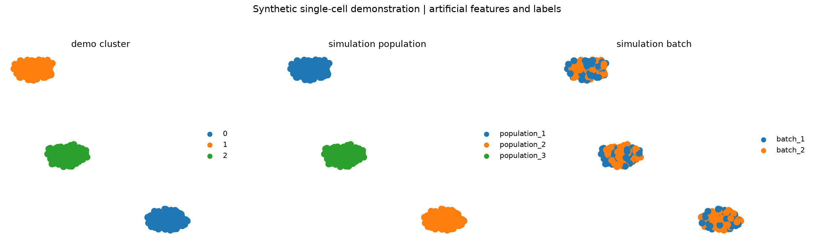

# Single-cell workflows in Python & R

**Scanpy · SoupX · Seurat · Sparse matrices · Reproducible analysis**

A programming portfolio by [Mohua Das](https://github.com/MD-Chem), demonstrating single-cell analysis with independently simulated data. The examples cover ambient-RNA correction, quality control, normalization, dimensionality reduction, clustering, exploratory feature ranking, and Python–R data exchange.

**Every cell, feature, label, and figure in this repository is artificial.** This is a new public demonstration, not a release of a research dataset or a study's analysis pipeline. It contains no biological findings.



The figure shows the executed Python example. Population and batch labels are invented simulation inputs; clusters are software outputs and have no cell-type interpretation.

## What the code demonstrates

| Component | Programming and analysis skills |
| --- | --- |
| [Synthetic data generator](scripts/make_synthetic_data.py) | NumPy simulation, SciPy sparse matrices, pandas metadata, AnnData, and aligned Matrix Market exports |
| [Scanpy workflow](scripts/scanpy_workflow.py) | QC filtering, count preservation, normalization, variable features, PCA, neighbors, UMAP, Leiden clustering, and exploratory feature ranking |
| [SoupX workflow](scripts/soupx_workflow.R) | Raw/filtered droplet alignment, provisional Seurat clusters, ambient-RNA estimation, correction, and portable count exports |
| [Seurat workflow](scripts/seurat_workflow.R) | SCTransform, graph clustering, UMAP, RNA-assay feature ranking, QC visualization, and optional scDblFinder scoring |
| [Python checks](tests/test_python.py) | Reproducibility, count-matrix orientation, invalid-input rejection, metadata boundaries, and an end-to-end analysis |

## Run the Python example

Use Python 3.12 from the repository root:

```bash
python -m venv .venv
source .venv/bin/activate
python -m pip install -r requirements.txt

python scripts/make_synthetic_data.py --output generated
python scripts/scanpy_workflow.py --input generated/synthetic.h5ad --output outputs/scanpy
python -m pytest -q
```

On Windows, activate the environment with `.venv\Scripts\Activate.ps1` in PowerShell.

The generator creates 360 artificial cells, 600 artificial features, and 180 background droplets by default. The seed and all simulation settings are explicit. It writes both AnnData and 10x-style Matrix Market files, with artificial identifiers such as `Gene0001` and `SIMCELL0001`.

The Scanpy run writes QC tables, cluster assignments, feature rankings, coordinates, PNG figures, a processed AnnData object, and provenance with package versions. Input counts remain in the `rawcounts` layer. The artificial QC-proxy features illustrate filtering; they are not mitochondrial genes.

Commands refuse to overwrite a nonempty output directory. To rerun, choose a fresh `--output` path.

## Run the R examples

Use R 4.4 or newer and first generate the synthetic inputs with Python:

```bash
Rscript scripts/install_r_packages.R

# Estimate ambient contamination from the synthetic raw/filtered matrices.
Rscript scripts/soupx_workflow.R --input-dir generated --output outputs/soupx

# Independent Seurat example using the generated filtered counts.
Rscript scripts/seurat_workflow.R --input-dir generated/filtered --output outputs/seurat
```

SoupX auto-estimation can be unstable on small artificial examples. If it fails, the script stops and explains the failure. To exercise the correction API with an explicit **assumed** contamination fraction, choose a fresh output directory:

```bash
Rscript scripts/soupx_workflow.R --input-dir generated --output outputs/soupx-assumed --rho 0.10
```

That 10% value is an illustrative assumption, not an estimate or a validated parameter. The output records which mode was used.

The corrected Matrix Market export can be read in Python:

```bash
python scripts/scanpy_workflow.py --input-dir outputs/soupx --output outputs/scanpy-after-soupx
```

For this route, the input is stored as `soupx_adjusted_counts`, keeping corrected values distinct from raw counts. To use the assumed-fraction run, set `--input-dir outputs/soupx-assumed`.

Optional doublet scoring requires additional Bioconductor packages:

```bash
Rscript scripts/install_r_packages.R --with-doublets
Rscript scripts/seurat_workflow.R --input-dir generated/filtered --output outputs/seurat-doublets --doublets true
```

This optional example uses an explicit 5% prior and retains all cells. The simulation has no doublet truth labels, so it does not measure doublet-detection accuracy.

## Validation and interpretation

- The Python workflow is executed on the generated data; the committed preview comes from that run. See [validation details](docs/VALIDATION.md).
- The R examples are reviewed against the tool documentation but have not been runtime-tested in the preparation environment. Package versions are recorded by `sessionInfo()` when run; the R installer is not a lockfile.
- Feature rankings describe simulated clusters. Their statistics are not evidence for biological mechanisms or comparisons between experimental conditions.
- These examples demonstrate APIs and data handling. Parameters are chosen for the toy input and are not recommendations for real datasets.
- Generated data and analysis output directories are excluded from version control. Only the explicitly selected synthetic preview is committed.

Read [data provenance](docs/DATA_PROVENANCE.md) for the simulation design and publication boundary.

## Tool documentation

- [Scanpy](https://scanpy.readthedocs.io/en/stable/) and [AnnData](https://anndata.readthedocs.io/en/stable/)
- [SoupX](https://github.com/constantAmateur/SoupX)
- [Seurat / SCTransform](https://satijalab.org/seurat/articles/sctransform_vignette)
- [scDblFinder](https://bioconductor.org/packages/scDblFinder/)

The scientific tools are developed by their respective authors. This repository demonstrates their use through a standalone portfolio implementation.
