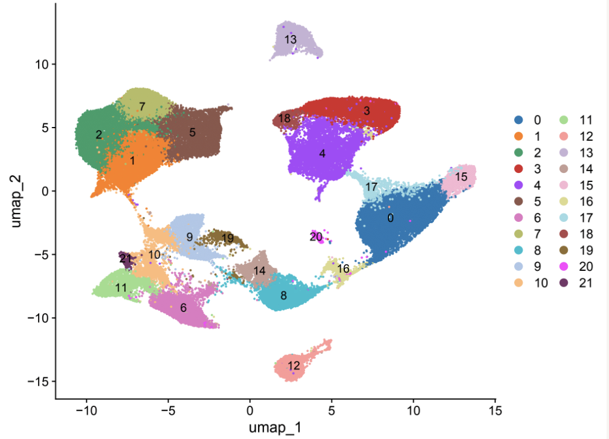
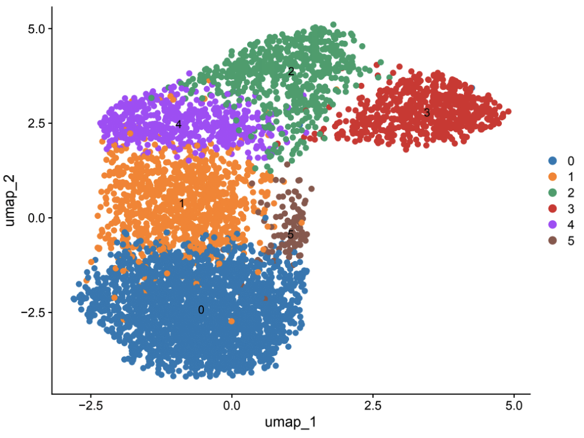

# My single-cell research portfolio

**Mohua Das, PhD · Cancer genomics · R and Python**

I use single-cell transcriptomics to connect experimental biology with changes in gene expression and cell states. This portfolio brings together code I used and adapted across three research projects, from count-matrix preprocessing and latent modelling to annotation, signature scoring and downstream analysis.

The manuscripts are in preparation. These are selected, edited excerpts of my working code: private paths and identifiers have been generalized, and study-specific annotations, embedded outputs and unpublished findings have been removed. Each project has its own page and code index so the methods can be explored without access to the research data.

## Explore the projects

| Project | Selected skills demonstrated | Start here |
| --- | --- | --- |
| **Anti-PD-L1 resistance in hepatocellular carcinoma** | SoupX, scDblFinder, Seurat, SCTransform, clustering and annotation | [Project and code](projects/hcc-pdl1-resistance/) |
| **Reversing immune tolerance in colorectal cancer using designed beta-catenin–TCF inhibitors (CRTi)** | Scanpy, AnnData, Scrublet, Seurat, DoubletFinder, SingleR, UCell, CytoTRACE; supporting bulk RNA-seq analysis | [Project and code](projects/crti-colorectal-cancer/) |
| **Characterisation of endothelial cells in progressive fatty liver disease in humans** | scvi-tools, Scanpy, Seurat, UCell, marker review and enrichment analysis | [Project and code](projects/fatty-liver-endothelial-cells/) |

## Find evidence of a skill

| What to inspect | Code example |
| --- | --- |
| Ambient-RNA correction with raw and filtered droplets | [SoupX and doublet checks](workflows/ambient-rna-and-doublets.Rmd) |
| Python preprocessing and per-capture doublet scoring | [10x / AnnData preprocessing](projects/crti-colorectal-cancer/notebooks/01-preprocessing.ipynb) · [Scrublet](projects/crti-colorectal-cancer/notebooks/02-filtering-scrublet.ipynb) |
| Scanpy normalization, PCA and neighborhood sensitivity | [Clustering notebook](projects/crti-colorectal-cancer/notebooks/03-clustering.ipynb) |
| scVI model setup, training and latent representation | [Human endothelial project](projects/fatty-liver-endothelial-cells/#python-notebooks) |
| R annotation, signature scoring and downstream analysis | [CRTi R workflows](projects/crti-colorectal-cancer/#r-workflows) · [Endothelial R workflow](projects/fatty-liver-endothelial-cells/#r-workflow) |

The [complete code index](docs/CODE_INDEX.md) distinguishes project workflows, supporting bulk analysis and the integration excerpts. Tool listings reflect implemented calls, not packages that were merely imported.

## A view of my HCC analysis

These two previously selected figures are real, unannotated archival outputs from the HCC project. They show numbered clusters without the biological labels or experimental comparisons. The public code has not been rerun to reproduce them.

| Clustering overview | Subset reclustering |
| --- | --- |
|  |  |

[Explore the HCC notebooks and figure context](projects/hcc-pdl1-resistance/). No figures or data from the other two projects are included.

## Reading the research code

The research notebooks require private count matrices, AnnData/Seurat objects or configuration files described in each excerpt. They are code portfolios, not self-contained reproductions of the studies. Jupyter outputs and execution counts are cleared; R Markdown analysis chunks are disabled by default. Package compatibility and numerical results have not been revalidated against the withheld inputs.

The edits retain substantive analysis steps and plotting code. Study-specific marker panels and annotation maps are supplied through private inputs instead of being embedded in the public files. Existing source and tutorial credits are retained where present.

[Provenance and sharing scope](docs/DATA_PROVENANCE.md) · [Validation record](docs/VALIDATION.md)

## Runnable Python companion

A separate Python/Scanpy example uses independently simulated data to demonstrate a complete, executable workflow. It was added for the portfolio and is distinct from the research excerpts above.

```bash
python -m venv .venv
source .venv/bin/activate
python -m pip install -r requirements.txt
python scripts/make_synthetic_data.py --output generated
python scripts/scanpy_workflow.py --input generated/synthetic.h5ad --output outputs/scanpy
python -m pytest -q
```

Use Python 3.12. On Windows, activate with `.venv\Scripts\Activate.ps1` in PowerShell. Output directories must be empty; choose a fresh output path for another run. The eight Python checks passed for this companion. Its pinned requirements do not define a tested environment for the research notebooks.

[Companion instructions and synthetic preview](docs/SYNTHETIC_EXAMPLE.md)

## About me

My background combines medicinal chemistry, chemical biology and cancer genomics. I am interested in research that connects computational analysis with experimental biology.

[GitHub profile](https://github.com/MD-Chem) · [ORCID](https://orcid.org/0000-0002-8891-6333) · [LinkedIn](https://www.linkedin.com/in/dmohua/)
